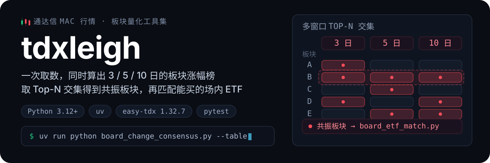
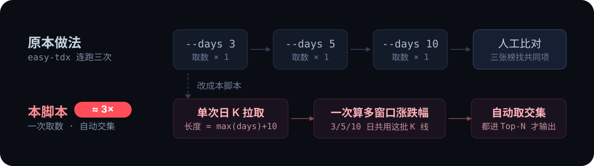
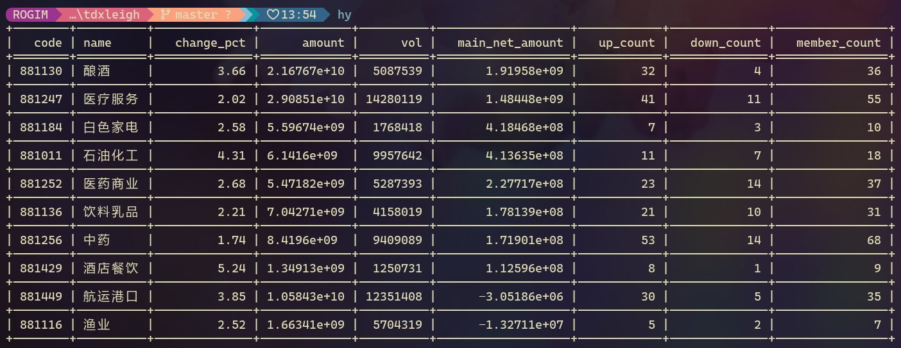
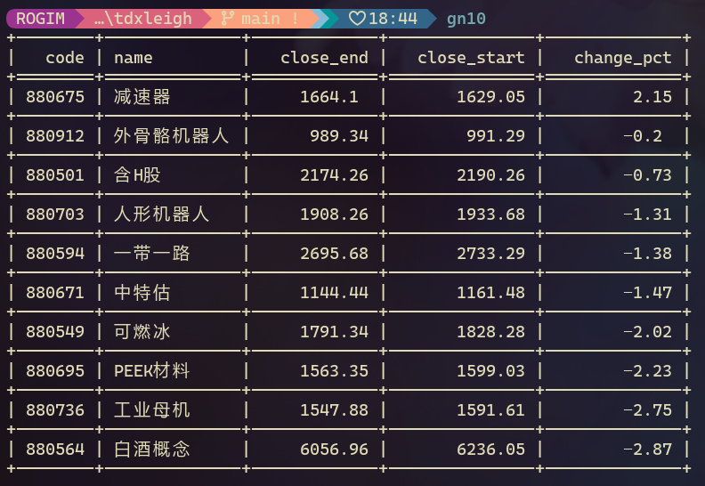
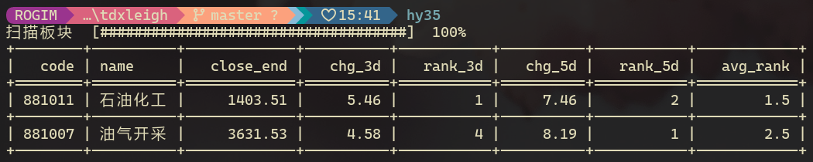
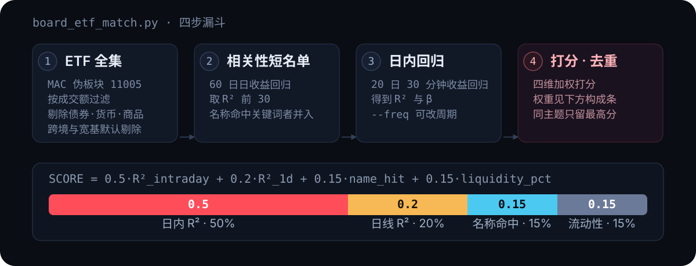
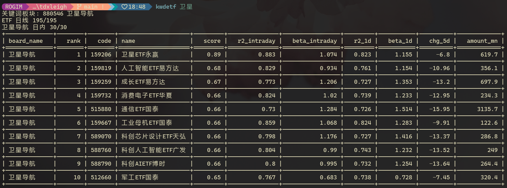
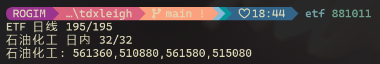

<p align="center">
  
</p>

# tdxleigh

板块量化小工具集，基于 **[easy-tdx](https://github.com/handsomejustin/easy-tdx) 1.32.7**（导入名 `easy_tdx`，CLI `easy-tdx`）的 MAC 通达信行情。

**典型流程**：先跑 **共振榜** → 再对板块跑 **ETF 匹配**。

## 工具一览

| 文件 | 作用 |
|------|------|
| `board_change_consensus.py` | 多周期涨幅榜 Top-N **交集**（共振板块） |
| `board_etf_match.py` | 为共振/指定板块匹配高相关、流动性好的场内 ETF |
| `cli_output.py` | `--table` 输出（CJK 对齐；JSON/CSV 仍走 `easy_tdx`） |
| `test/` | pytest 单元测试（替身客户端，无需联网） |

## 快速开始（uv）

需要 [uv](https://docs.astral.sh/uv/) 与 Python 3.12+（`requires-python = >=3.12,<3.14`）。

**easy-tdx 1.32.7** 与 conda 一致，但 **不在 pypi.org**；`pip` 若配置了清华/阿里镜像能直接装。本项目在 `vendor/wheels/`  vendoring 同版本 wheel，并在 `pyproject.toml` 用 `[tool.uv.sources]` 指向它；其余包默认走清华镜像。`easy-tdx` 要求 **pandas 2.x**（已锁定 `<3`）。

```bash
cd tdxleigh
uv sync --all-groups
uv run easy-tdx --help
uv run python board_change_consensus.py --help
uv run python board_etf_match.py --help
```

---

## `board_change_consensus.py` — 板块共振榜



### 做什么

在指定板块类型（行业 HY、概念 GN 等）下，对每个板块只拉一次日 K（长度 ≈ `max(days) + 缓冲`），一次算出各窗口涨跌幅，再筛出在**每一个**窗口都进入 Top-N 的板块。

等价于多次运行 `easy-tdx board-change-ranking` 后人工找交集，但通常快约 3 倍（少重复拉 K 线）。

### 输出示例

原本做法是分别运行 `easy-tdx board-change-ranking`，再人工比对这样的单日榜单：

<p align="center">
  
  
</p>

本脚本一条命令直接得到交集（示例：`--type HY --days 3,5`，扫描进度条走 stderr）：

<p align="center">
  
</p>

### 用法

```bash
uv run python board_change_consensus.py --type HY --days 3,5,10 --top 10 --table
uv run python board_change_consensus.py --type GN --days 3,5 --top 5 --table
uv run python board_change_consensus.py --type HY --days 3,5,7,13 --top 10 --table
uv run python board_change_consensus.py --type GN --top 15 --names-only
uv run python board_change_consensus.py --type HY --date 20250530 --output csv
uv run python board_change_consensus.py --type HY --asc --table          # 跌幅共振
```

常用选项：

| 选项 | 说明 |
|------|------|
| `--type` | `HY` / `GN` / `FG` / `DQ` / `ALL`（默认 `HY`） |
| `--days` | 逗号分隔的交易日窗口，如 `3,5,10`（默认 `3,5,10`） |
| `--top` | 每个窗口的名次门槛（默认 `10`） |
| `--date` | 截止日 `YYYYMMDD`（默认最新） |
| `--table` / `--output` | 表格 / `json` / `csv`（默认 JSON） |
| `--names-only` | 只打印板块名称 |
| `--progress` / `--no-progress` | stderr 扫描进度条 |

### 输出列

`code`, `name`, `close_end`，随后各窗口成对出现 `chg_{w}d`, `rank_{w}d`，最后一列 `avg_rank`（各窗口名次均值，越小越强）。

---

## `board_etf_match.py` — 板块 → ETF



### 匹配方法

1. ETF 全集：MAC 伪板块 `11005`，按成交额过滤，剔除债券/货币/跨境/商品，默认剔除宽基。
2. 短名单：全体 ETF 与板块指数做 60 日日收益回归，取 R² 前 30 + 名称命中板块关键词者。
3. 日内回归：短名单与板块指数做 20 日 30 分钟收益回归（R²、β）。
4. 打分：`0.5·R²_intraday + 0.2·R²_1d + 0.15·name_hit + 0.15·liquidity_pct`；同主题只留最高分。

通达信协议不提供 ETF 持仓/跟踪指数，以收益相关性代替持仓重合度。

### 用法

板块代码写在**所有选项之后**（方便 Nu 脚本把 ticker 放末尾）：

```bash
uv run python board_etf_match.py --table                           # 先跑共振榜，再逐板块匹配
uv run python board_etf_match.py --table 881289
uv run python board_etf_match.py --keywords 卫星 --table              # 不给代码：按名称搜“卫星”相关板块
uv run python board_etf_match.py --keywords 卫星,军工 --tickers-only 881289
uv run python board_etf_match.py --freq 5 --intraday-days 10 881289
uv run python board_etf_match.py --include-broad --keep-duplicates 881289
uv run python board_etf_match.py --tickers-only 881289 881007
```

### 输出示例

板块 → ETF 的完整匹配表（示例：`--keywords 卫星`，板块 `880546 卫星导航`）：

<p align="center">
  
</p>

运行进度与 `--tickers-only` 精简输出（示例：板块 `881011 石油化工`）：

<p align="center">
  
</p>

### 输出列

`board_name`, `rank`, `code`, `name`, `score`, `r2_intraday`, `beta_intraday`, `r2_1d`, `beta_1d`, `chg_5d`, `amount_mn`（成交额，百万元）。

---

## 测试

```bash
uv run pytest
```

---

## 附录：Shell 别名（Nushell / PowerShell / WSL Bash）

> 这一节与工具本身无关，只是把正文里那些 `uv run …` 长命令缩成一个词的**可选**配置。不需要就直接跳过。

### 别名写在哪、怎么改

| Shell | 配置文件 | 打开方式 |
|------|----------|----------|
| Nushell | `%APPDATA%\nushell\config.nu` | `code $nu.config-path` |
| PowerShell 7（`pwsh`） | `~\Documents\PowerShell\Microsoft.PowerShell_profile.ps1` | `code $PROFILE` / `notepad $PROFILE` |
| Windows PowerShell 5.1 | `~\Documents\WindowsPowerShell\Microsoft.PowerShell_profile.ps1` | 同上 |
| Bash（WSL / Ubuntu） | `~/.bash_aliases` | `nano ~/.bash_aliases`（Ubuntu 的 `~/.bashrc` 会自动加载它，不用改 `.bashrc`） |

路径以 shell 自己的变量为准：**`$PROFILE` 的取值随 PowerShell 版本而变**（本机 5.1 与 7 指向两个不同目录），先 `echo $PROFILE` 确认再动手。WezTerm 只是终端模拟器，不决定配置文件位置。

**操作步骤：**

1. 打开上表中属于你那个 shell 的文件。文件不存在就新建：PowerShell 用 `New-Item -Path $PROFILE -ItemType File -Force`；Nushell 先 `print $nu.config-path` 看路径，再新建同名文件。
2. 把下面对应 shell 的代码块**整段**粘贴进去。两套写法不要混贴。
3. 改一处路径：`TDXLEIGH_DIR`（Nushell / Bash）/ `$TDXLEIGH_DIR`（PowerShell）—— 填本机仓库的实际路径。仓库换位置后只需要再改这一处。
4. 让它生效：重开一个终端窗口即可；不想重开的话，Nushell 执行 `source $nu.config-path`，PowerShell 执行 `. $PROFILE`，Bash 执行 `source ~/.bashrc`。
5. PowerShell 若提示禁止运行脚本，先跑一次 `Set-ExecutionPolicy -Scope CurrentUser RemoteSigned`。

日常要调的是别名右侧的命令 —— 它们就是正文 CLI 用法里那些 `uv run …` 命令的缩写形式，改参数即可，不用动左侧别名名。

### 别名说明

基础别名（其余别名都建立在它们之上，可在任意目录调用）：

| 别名 | 展开为 | 说明 |
|------|--------|------|
| `tdxe` | `uv run --directory <项目目录> easy-tdx` | 在本项目的 uv 环境里调用 `easy-tdx` CLI |
| `tdxp` | `uv run --directory <项目目录> python` | 在本项目的 uv 环境里运行 Python 脚本（工作目录切到项目，脚本可用相对路径） |

行业板块（HY）：

| 别名 | 说明 |
|------|------|
| `hy` | 行业板块实时排名，按**主力净流入**（`main_net_amount`）排序，取前 10，看今天资金往哪个行业走 |
| `hy35` | 行业**短线共振**：3 日、5 日涨幅都进前 5 的行业 |
| `hy35713` | 行业**多周期共振**：3/5/7/13 日涨幅都进前 10，筛出短中期一致走强的行业 |
| `hy23` | 行业 23 日（约一个月）涨幅榜前 5，看中期主线 |

概念板块（GN）：

| 别名 | 说明 |
|------|------|
| `gn` | 概念板块实时排名，按**成交额**排序，取前 10，看今天最活跃的题材 |
| `gn35` | 概念**短线共振**：3 日、5 日涨幅都进前 5 的概念 |
| `gn10` | 概念 10 日涨幅榜前 10，看近两周的强势题材 |

市场与个券：

| 别名 | 说明 |
|------|------|
| `mkstats` | 全市场统计（涨跌家数等），判断整体情绪 |
| `clun516` | 对深市 `159516` 做缠论分析，30 分钟级别多级别联立，取最近 120 根 K 线 |

板块 → ETF 匹配（板块代码写在最后，可多个）：

| 别名 | 用法示例 | 说明 |
|------|----------|------|
| `etf` | `etf 881289 881007` | 每个板块一行，只列匹配到的 ETF 代码，方便复制下单 |
| `kwdetf` | `kwdetf 卫星` / `kwdetf 卫星,军工 881289` | 只给关键词：自动找出名称含关键词的板块（如“卫星导航”）再匹配 ETF；关键词后再跟板块代码：只匹配这些板块。两种情况下名称含关键词的 ETF 都会进入候选并加分，表格输出 |
| `tabletf` | `tabletf 880729` | 表格输出，日内回归用最近 **3 个交易日的 30 分钟** K 线，反映最新的短线跟随度 |

`etf`、`kwdetf`、`tabletf` 后面还可以追加 `board_etf_match.py` 的其他选项（如 `--min-score 0.5`），但选项要放在板块代码**之前**。

### Nushell 版本（`config.nu`）

粘贴到 `config.nu` 末尾即可（`code $nu.config-path` 打开该文件）。

```nu
# ===== tdxleigh aliases (Nushell) =====
const TDXLEIGH_DIR = "P:\\Python-Scripts\\QMT\\tdxleigh"

# --- 基础 ---
alias tdxe = uv run --directory $TDXLEIGH_DIR easy-tdx
alias tdxp = uv run --directory $TDXLEIGH_DIR python

# --- 行业板块 HY ---
alias hy      = tdxe board-ranking --type HY --top 10 --sort-by main_net_amount --table
alias hy35    = tdxp board_change_consensus.py --type HY --days 3,5 --top 5 --table
alias hy35713 = tdxp board_change_consensus.py --type HY --days 3,5,7,13 --top 10 --table
alias hy23    = tdxe board-change-ranking --type HY --days 23 --top 5 --table

# --- 概念板块 GN ---
alias gn   = tdxe board-ranking --type GN --top 10 --sort-by amount --table
alias gn35 = tdxp board_change_consensus.py --type GN --days 3,5 --top 5 --table
alias gn10 = tdxe board-change-ranking --type GN --days 10 --top 10 --table

# --- 市场 / 个券 ---
alias mkstats = tdxe market-stat --table
alias clun516 = tdxe chanlun SZ 159516 --multi-level 30MIN --count 120 --table

# --- 板块 → ETF ---
alias etf     = tdxp board_etf_match.py --tickers-only
alias kwdetf  = tdxp board_etf_match.py --table --keywords
alias tabletf = tdxp board_etf_match.py --table --freq 30 --intraday-days 3
```

### PowerShell 版本（`$PROFILE`）

PowerShell 的 `Set-Alias` 不能带参数，所以这里用函数，`@args` 把你追加的参数（板块代码等）原样传下去。粘贴到 `$PROFILE`（用 `notepad $PROFILE` 打开）后重开终端即可。

> **注意：** PowerShell 会把裸写的 `3,5` 当成数组拆开传参，因此 `--days` 的值都加了单引号；调用 `kwdetf` 时关键词也要加引号：`kwdetf '卫星,军工' 881289`。

```powershell
# ===== tdxleigh aliases (PowerShell) =====
$TDXLEIGH_DIR = 'P:\Python-Scripts\QMT\tdxleigh'

# 让中文板块名 / ETF 名正常显示
[Console]::OutputEncoding = [System.Text.UTF8Encoding]::new()

# --- 基础 ---
function tdxe { uv run --directory $TDXLEIGH_DIR easy-tdx @args }
function tdxp { uv run --directory $TDXLEIGH_DIR python @args }

# --- 行业板块 HY ---
function hy      { tdxe board-ranking --type HY --top 10 --sort-by main_net_amount --table @args }
function hy35    { tdxp board_change_consensus.py --type HY --days '3,5' --top 5 --table @args }
function hy35713 { tdxp board_change_consensus.py --type HY --days '3,5,7,13' --top 10 --table @args }
function hy23    { tdxe board-change-ranking --type HY --days 23 --top 5 --table @args }

# --- 概念板块 GN ---
function gn   { tdxe board-ranking --type GN --top 10 --sort-by amount --table @args }
function gn35 { tdxp board_change_consensus.py --type GN --days '3,5' --top 5 --table @args }
function gn10 { tdxe board-change-ranking --type GN --days 10 --top 10 --table @args }

# --- 市场 / 个券 ---
function mkstats { tdxe market-stat --table @args }
function clun516 { tdxe chanlun SZ 159516 --multi-level 30MIN --count 120 --table @args }

# --- 板块 → ETF ---
function etf     { tdxp board_etf_match.py --tickers-only @args }
function kwdetf  { tdxp board_etf_match.py --table --keywords @args }
function tabletf { tdxp board_etf_match.py --table --freq 30 --intraday-days 3 @args }
```

### WSL / Ubuntu Bash 版本（`~/.bash_aliases`）

在 WSL 里跑同一套命令，只多两件事：盘符写成 `/mnt/p`，虚拟环境要重新建一份。

**第一步：确认 `P:` 挂上了，uv 装好了**

```bash
ls /mnt/p        # 应该能看到 Python-Scripts
curl -LsSf https://astral.sh/uv/install.sh | sh
```

`/mnt/p` 是空的、或者压根不存在（网络盘和移动盘常这样），手动挂一次：

```bash
sudo mkdir -p /mnt/p
sudo mount -t drvfs P: /mnt/p
```

想每次开机都有，往 `/etc/fstab` 加一行：

```
P: /mnt/p drvfs defaults 0 0
```

**第二步：把下面这段放进 `~/.bash_aliases`**

```bash
# ===== tdxleigh aliases (bash / WSL) =====
export TDXLEIGH_DIR="/mnt/p/Python-Scripts/QMT/tdxleigh"

# --- 基础 ---
# 用函数而不是 alias：Linux 侧的虚拟环境设置只作用在这两条命令上
tdxe() { UV_PROJECT_ENVIRONMENT="$HOME/.venvs/tdxleigh" UV_LINK_MODE=copy uv run --directory "$TDXLEIGH_DIR" easy-tdx "$@"; }
tdxp() { UV_PROJECT_ENVIRONMENT="$HOME/.venvs/tdxleigh" UV_LINK_MODE=copy uv run --directory "$TDXLEIGH_DIR" python "$@"; }

# --- 行业板块 HY ---
alias hy='tdxe board-ranking --type HY --top 10 --sort-by main_net_amount --table'
alias hy35='tdxp board_change_consensus.py --type HY --days 3,5 --top 5 --table'
alias hy35713='tdxp board_change_consensus.py --type HY --days 3,5,7,13 --top 10 --table'
alias hy23='tdxe board-change-ranking --type HY --days 23 --top 5 --table'

# --- 概念板块 GN ---
alias gn='tdxe board-ranking --type GN --top 10 --sort-by amount --table'
alias gn35='tdxp board_change_consensus.py --type GN --days 3,5 --top 5 --table'
alias gn10='tdxe board-change-ranking --type GN --days 10 --top 10 --table'

# --- 市场 / 个券 ---
alias mkstats='tdxe market-stat --table'
alias clun516='tdxe chanlun SZ 159516 --multi-level 30MIN --count 120 --table'

# --- 板块 → ETF ---
alias etf='tdxp board_etf_match.py --tickers-only'
alias kwdetf='tdxp board_etf_match.py --table --keywords'
alias tabletf='tdxp board_etf_match.py --table --freq 30 --intraday-days 3'
```

**第三步：让它生效**

```bash
source ~/.bashrc
```

#### 跟 Nushell 版比，改了什么

- `const` 换成 `export`，`P:\...` 换成 `/mnt/p/...`。
- `tdxe` / `tdxp` 写成函数而不是 `alias`，因为要在这两条命令上各挂两个环境变量。bash 的 alias 可以调用另一个别名或函数，所以 `hy` 里直接写 `tdxe` 就行，展开后照样认得这个函数。
- 别名内容用单引号包住，`$TDXLEIGH_DIR` 才是运行时才取值。用双引号的话，值在定义那一刻就被钉死了，以后改 `TDXLEIGH_DIR` 不生效。
- `3,5` 在 bash 里不会被拆开，所以 `--days` 不用加引号 —— 这一点跟 PowerShell 相反。
- `UV_PROJECT_ENVIRONMENT` 让 WSL 在 `~/.venvs/tdxleigh` 建自己的虚拟环境。仓库里现有的 `.venv` 是 Windows 侧建的（里面是 `Scripts\` 而不是 `bin/`），Linux 的 Python 用不了，uv 会重建一份，第一次跑要等一会儿。
- `UV_LINK_MODE=copy` 是保险项。缓存和虚拟环境都在 ext4 上时，硬链接本来就能用；哪天把 `UV_PROJECT_ENVIRONMENT` 指到 `/mnt/...`，跨文件系统做不了硬链接，uv 才需要退回复制。
- alias 只在交互式 shell 里展开。写进脚本的话，直接调 `tdxe` 函数，或者先 `shopt -s expand_aliases`。

#### 两个要留意的地方

**行情本身不依赖 Windows。** `easy_tdx` 的 wheel 是 `py3-none-any`，纯 Python，里面没有 DLL、也没有 ctypes 调用，在线行情走 TCP，WSL 里能直接连。唯一看 `sys.platform` 的地方是 `easy_tdx/offline/paths.py` 里探测本地通达信安装目录（vipdoc）那一段，本项目的两个脚本只取在线 MAC 行情，不碰它；真要读离线数据，把 `TDX_HOME` 指到目录即可。

**跨盘读文件会慢一点。** 从 `/mnt/p` 读脚本比 ext4 慢，这几条命令用起来没差别，就是每次启动多花一点点时间。

要在 WSL 里转调 Windows 侧的 Nushell 别名，可以试 `nu.exe -c "hy"`；这条没在本机实测过，能不能通取决于你的 `nu.exe` 是否在 `PATH` 里。用 zsh 的话，把同一段放进 `~/.zshrc` 就行。

## License

[MIT](LICENSE) © XstormLeigh
